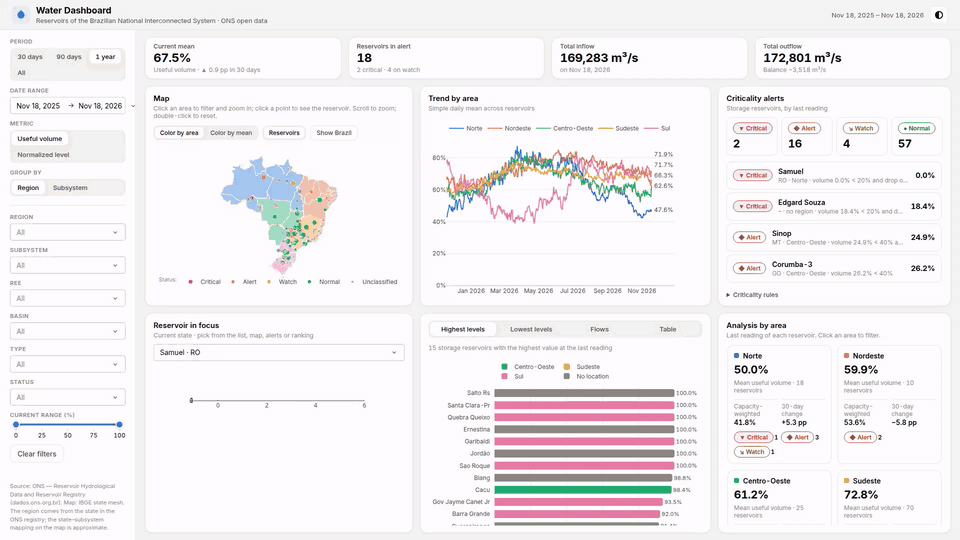

# Water Dashboard

[](https://github.com/marcotuliocarvalho/Reservoir-Watch/actions/workflows/ci.yml)

**Live demo:** <https://reservoir-watch.onrender.com> (data since 2020; the
free server sleeps when idle, so the first visit can take about a minute).

<picture>
  <source media="(prefers-color-scheme: dark)" srcset="docs/demo-dark.gif">
  
</picture>

Ingestion pipeline and interactive dashboard for the reservoirs of Brazil's
National Interconnected System (SIN), built on open data from
[ONS](https://dados.ons.org.br) (Operador Nacional do Sistema Elétrico).

- **Ingestion**: discovers the yearly Parquet files in the ONS catalog,
  downloads them, cleans them and writes one processed file. Runs daily in
  Airflow.
- **Dashboard**: a Dash app with a map of Brazil, criticality alerts, trends by
  region or subsystem, flows, a ranking of the lowest reservoirs and a
  detailed table.

## Architecture

```
ONS CKAN API ──> discover ──> download (1 task per year) ──> clean + transform ──> data/*.parquet ──> Dash dashboard
                 └─────────────── Airflow DAG: hidrico_ingestion (@daily) ───────────────┘
```

| Path | Role |
|------|------|
| `src/ingestion/catalog.py` | Lists the yearly Parquet URLs of the `dados-hidrologicos-res` dataset |
| `src/ingestion/reader.py` | Downloads and lazily scans Parquet files with Polars |
| `src/ingestion/cleaning.py` | Casts timestamps, drops rows without id or time and duplicated readings |
| `src/ingestion/transform.py` | Normalizes the upstream level by each reservoir's historical maximum |
| `src/ingestion/pipeline.py` | Plain pipeline functions and the Airflow DAG factory |
| `dags/hidrico_ingestion.py` | Airflow entry point |
| `src/visualization/` | Dash app: data prep, charts, layout, callbacks, theme |
| `Dockerfile` | Airflow image |
| `Dockerfile.dashboard` | Dashboard image (bundles the reservoir registry) |
| `docker-compose.yaml` | Full stack: `airflow` and `dashboard` services |
| `deploy/render/`, `render.yaml` | Self-contained demo image and Render Blueprint |
| `tests/` | Unit and smoke tests (pytest) |
| `.github/workflows/` | CI (lint, tests, DAG, Docker builds) and demo deploy |

## Dashboard features

- Single-screen layout on desktop (window at least 1100×600 px): filters in a
  left sidebar, KPIs on top and a 3×2 grid with the map, trend, alerts,
  reservoir in focus, highest levels / lowest levels / flows / table (tabs) and
  analysis by area.
  Long lists scroll inside their card. Smaller screens fall back to one
  scrolling column.
- Filters by period, region, subsystem, REE, basin, reservoir type, status and current value range.
- Two metrics: **useful volume** (% of maximum useful volume) and **normalized level**.
- Rankings of the 15 fullest storage reservoirs and the 15 lowest reservoirs at
  the last reading (the fullest tab opens first; run-of-river plants are left
  out of it because they always sit near 100%). Click a bar to focus that
  reservoir.
- Map colored by area or by mean value, with reservoir markers by status. Click an area to filter and zoom.
- Criticality status for storage reservoirs (types RCU, RES, RBB), always by useful volume:

  | Status | Rule |
  |--------|------|
  | Critical | useful volume below 20% |
  | Alert | useful volume between 20% and 40% |
  | Watch | drop of 10 pp or more in 30 days |
  | Normal | no triggers |
  | Unclassified | run-of-river or no volume reading |

  These are reference thresholds, not an official ONS criterion.
- Light and dark theme, saved per browser.

## Requirements

- Python 3.12+
- Docker and Docker Compose (to run the full stack)

## Setup

```bash
python -m venv .venv
source .venv/bin/activate
pip install -r requirements.txt
cp .env.example .env
```

The dashboard uses the ONS reservoir registry for coordinates, states and
capacity. Download it once (it is not versioned):

```bash
curl -o src/visualization/static/reservatorios.parquet \
  https://ons-aws-prod-opendata.s3.amazonaws.com/dataset/reservatorio/RESERVATORIOS.parquet
```

Without this file the dashboard still runs, but the map and the region data stay empty.

## Running with Docker (recommended)

```bash
cp .env.example .env
mkdir -p data
docker compose up --build
```

This starts the full stack:

- Airflow: http://localhost:8080
- Dashboard: http://localhost:8050

The dashboard image downloads the reservoir registry at build time. The
dashboard waits until the first DAG run writes the processed dataset, then
starts. It loads the data once, so restart it to see new runs:
`docker compose restart dashboard`.

## Running the ingestion

### With Airflow

Run `docker compose up --build` as above. The `hidrico_ingestion` DAG runs daily and writes:

- `data/raw/DADOS_HIDROLOGICOS_RES_<year>.parquet`: raw yearly files. Closed years are downloaded only once; the current year is refreshed on every run.
- `data/reservatorios_hidrologicos.parquet`: the processed dataset.

To ingest only some years, trigger the DAG with the `years` param, for example `[2024, 2025]`.

### Without Airflow

```bash
python -m src.ingestion                    # all years, preview only
python -m src.ingestion 2024 2025          # some years, preview only
python -m src.ingestion --write            # download and write the dataset
python -m src.ingestion --write --since 2020  # only 2020 up to now
```

Without `--write`, the pipeline runs in memory and prints a preview. With
`--write`, it downloads the yearly files (4 in parallel) to
`$HIDRIC_DATA_DIR/raw` and writes the processed dataset, like one DAG run.

## Running the dashboard

```bash
python -m src.visualization                          # reads HIDRIC_DATA_DIR, then ./data
python -m src.visualization --source "data/raw/*.parquet"
python -m src.visualization --port 8050 --debug
python -m src.visualization --export dashboard.parquet  # prepared dataset, no server
```

Open http://127.0.0.1:8050. `--source` takes a file, a directory or a glob
pattern. Raw ONS files go through the cleaning pipeline automatically.

## Tests

```bash
pip install -r requirements-dev.txt
ruff check .
pytest --cov=src
```

The tests use small synthetic frames shaped like the ONS files and never call
the network. The DAG test runs only when Airflow is installed (the CI has a
separate job for it).

## CI and online demo

GitHub Actions runs on every push and pull request:

- `ci.yml`: lint (ruff), tests with coverage, Airflow DAG import, and build of
  both Docker images.
- `deploy-demo.yml`: rebuilds the online demo every day, so it shows fresh
  ONS data.

The demo runs on the [Render](https://render.com) free tier (512 MB RAM). Its
image (`deploy/render/Dockerfile`) does not use Airflow. At build time it
ingests only the years since 2020 (`python -m src.ingestion --write --since
2020`) and keeps just the prepared dashboard dataset
(`python -m src.visualization --export`). The server then uses about 280 MB.
In the demo, the normalized level uses the highest level since 2020, not
the full history.

To set it up, once:

1. On Render, open New > Blueprint and select this repository. Render reads
   `render.yaml` and creates the `reservoir-watch` web service. Later deploys
   run when the GitHub checks pass on `main`.
2. For the daily refresh, create an API key in Render (Account settings > API
   Keys). In GitHub, open Settings > Secrets and variables > Actions. Add the
   secret `RENDER_API_KEY` and the variable `RENDER_SERVICE_ID` (the `srv-...`
   id in the service URL).

Free Render services sleep after 15 minutes without visits. The next visit
wakes the service up in about a minute.

## Configuration

| Variable | Default | Use |
|----------|---------|-----|
| `HIDRIC_URL` | `https://dados.ons.org.br/api/3/action/package_show` | ONS CKAN endpoint |
| `HIDRIC_DATASET_ID` | `dados-hidrologicos-res` | ONS dataset id |
| `HIDRIC_DATA_DIR` | `./data` | Where the DAG writes and the dashboard reads |
| `HIDRIC_REGISTRY` | `src/visualization/static/reservatorios.parquet` | Reservoir registry file |
| `AIRFLOW_UID` | `50000` | User id for the Airflow container (use `id -u`) |

## Data sources

- ONS: [Dados Hidrológicos de Reservatórios](https://dados.ons.org.br/dataset/dados-hidrologicos-res) and [Reservatórios](https://dados.ons.org.br/dataset/reservatorio).
- IBGE: state mesh used on the map.

The state–subsystem mapping on the map is approximate.

## Stack

Python · Polars · Dash · Plotly · Apache Airflow 3 · Docker
